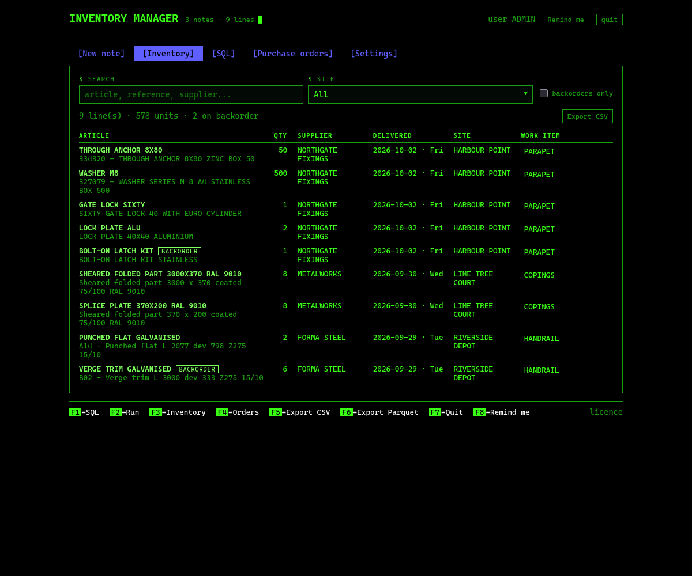
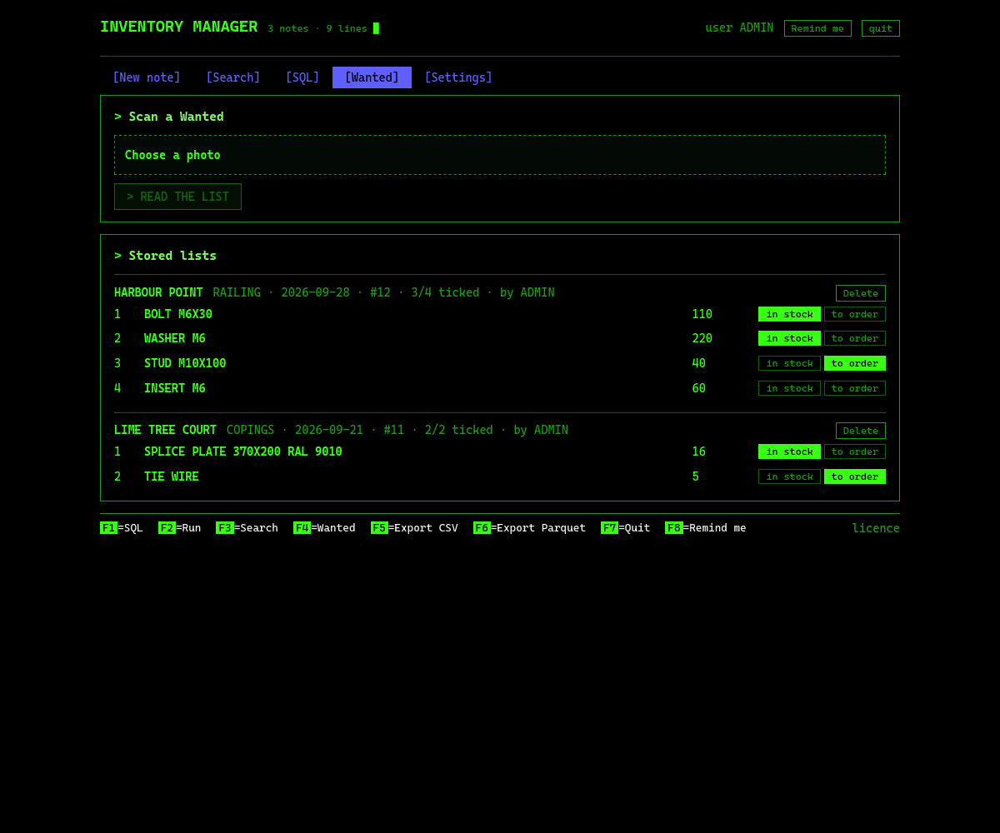
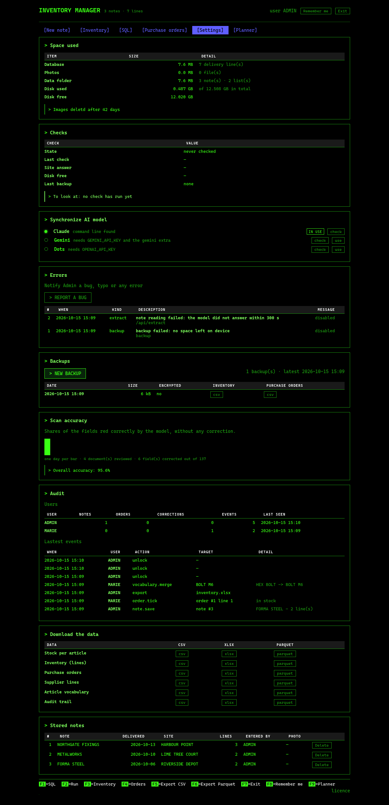

# Inventory manager

A software ERP for Inventory management. Photograph each Delivery note you receive and it is transcripted ,by duckdb, to a database*. You can then check the data under "Inventory", sort it, export it or query it with SQL.
Same for Purchase orders. The goal is to report a company's inventory without having to manually audit it. The two bottlenecks will narrow down stocks: hardware input and outputs. 
Custom built to answer a real company's needs on inventory tracking. 

each article stored in [inventory] database has its own line with indicators such as : name, quantity, supplier name, delivery date, order date, order reference and additional information.

for those stored in [Purchase order] "in stock" or "to order" clickable option are available: You can then export them as, regardless of the purchase order #, to bulk order them. 

```
photo -> model -> you check it -> DuckDB -> search, SQL, questions, exports
```

*computer vision is used, you must synchronize your AI model for recognition. More models compatibility to come.






## Install

Python 3.11

```bash
pipx install git+https://github.com/Louis31921c/Inventory-Manager.git#subdirectory=stock-manager
```


Once in, plug your model ;

Computer vision is used, you must synchronize your AI model for recognition. As of now, two models are compatible. More models to come. Feel free to make it run on your own model !

- **Claude Code CLI** (default): install it, run `claude` once and `/login`. No API key.
- **Gemini API**: `pip install "stock-manager[gemini]"`, then put `LLM_BACKEND=gemini` and
  `GEMINI_API_KEY=...` in the settings file.

Except snapping photos, Everything else works with no model at all.

## The password

The first time the window opens it asks for a name and a password. After that the
app is locked on every start for quick acess: the right password opens your data. You still can disconnect after each session but five wrong tries pause it for five minutes.

the session expires on its own after 12 hours.

## What protects the data

| Guard | What it stops |
|---|---|
| Loopback only, random port | nothing on the network can reach it |
| Password on open, scrypt hash, five tries per five minutes | someone sitting down at your machine |
| Signed session cookie, `SameSite=strict`, twelve hours | another site reusing your session |
| Origin check on every write | a page in your browser posting to the app |
| Read-only SQL, filesystem access off, one statement | a question turning into a delete |
| `0600` on the database, settings and account file, `0700` on the data folder | other accounts on the machine |
| 30 MB cap on uploads, photos purged after six weeks | the disk filling up quietly |
| Encrypted snapshots when `BACKUP_PASSPHRASE` is set | a stolen backup |

For a laptop that leaves the workshop, turn on full disk encryption.

### The five tabs

Press `1` to `5` to navigate between tables.

| Tab | What you do |
|---|---|
| New note | `R` snaps a photo. Correct the fields and lines, then save. |
| Search | `/` filters, `B` shows backorders only, `E` edits the work item of a line. |
| SQL | `Enter` query it yourself. You can export it as csv, parquet or xslx for more options. |
| Purchase orders | `R` reads a sheet. `S` in stock, `O` to order, `C` clears, `D` deletes. |
| Settings | `B` backup, `T` test message, `M` merge two names, `E` export, `P` purge photos. |

### Keys everywhere

| Key | Does |
|---|---|
| F1 | SQL tab |
| F2 | ask a question |
| F3 | search |
| F4 | purchase orders |
| F5 / F6 | export |
| F7 | quit |
| F9 | predictions |
| Ctrl-U | clear the line you are typing |
| Esc | cancel |


## Data in

Four ways in, all landing in the same queue on the first screen.

| Way in | What it takes |
|---|---|
| Take a picture | a delivery note or a purchase order, read on the spot |
| Import files | PDF, JPG, PNG, WEBP read like a photo; CSV and XLSX mapped column by column |
| Mailbox | attachments on unread mail, fetched on a timer or by hand |
| Terminal | `stock read`, as before |

The queue keeps one copy of each file: the same bytes twice, from a mail and from a folder,
stay one row. A scan waits for `read`, a spreadsheet for `map columns`.

### Spreadsheets

The column mapping is guessed from the header, in English or French (`article`, `quantite`,
`fournisseur`, `date livraison`, `chantier`), and you correct it before anything is written.
`Check` says what would be imported and what would be skipped, with the reason and the row
number; `Import` writes the lines as one note of their own, so an import can be found again
later. Pick `Supplier catalogue` as the target and the same file fills the catalog instead.

### Mailbox

Plain IMAP, set in `~/.config/stock-manager/settings.env`:

```
IMAP_HOST=127.0.0.1
IMAP_PORT=1143
IMAP_USER=you@proton.me
IMAP_PASSWORD=the-bridge-password
IMAP_FOLDER=INBOX
IMAP_SECURITY=starttls
IMAP_INSECURE=1
MAIL_EVERY_MINUTES=15
```

Those values are for **Proton Mail Bridge**, which runs on your machine and offers Proton over
IMAP on `127.0.0.1:1143` with a certificate of its own, hence `IMAP_INSECURE=1` for that host
only. It needs a paid Proton plan.

**Outlook.com and Microsoft 365 no longer accept IMAP passwords**: Microsoft retired Basic
authentication there and app passwords are not a way around it. Either use a corporate account
whose tenant still allows IMAP, or set an Outlook rule that forwards supplier mail to an
address this can read.

Only attachments are taken, and only the kinds this app can read. The message is marked read so
it is not picked up twice (`IMAP_MARK_READ=0` to leave it alone), and the poll runs every
`MAIL_EVERY_MINUTES` while the app is open. `Fetch now` and `Test the connection` are on the
first screen.

## Downloads

Three tables come out of the app, and they are the same three everywhere: the Settings tab,
and the buffers card in the DDMRP window.

| Download | What is in it | Key |
|---|---|---|
| Inventory lines | every line of every delivery note | `id`, with `note_id` and `line_no` as they were read |
| Purchase order lines | every line of every stored purchase order, with its sheet | `id`, with `list_id` and `line_no` |
| Safety stock watch | one row per article: rate, lead time, zones, net flow, what to order | `article` |

Each one comes as `csv`, `xlsx` or `sql`.

### Querying them in psql

The `sql` files are plain PostgreSQL. Every one of them creates the `stock` schema if it is
missing, creates its own table if it is missing, empties that table and fills it again, so a
file can be loaded as often as you like without piling rows up.

```
createdb workshop
psql -d workshop -f inventory_lines.sql
psql -d workshop -f purchase_order_lines.sql
psql -d workshop -f safety_stock.sql
```

The three relate through `stock.articles`, a one column table every file tops up and every line
points at, so the tables can be loaded in any order and joined straight away:

```sql
SELECT a.article,
       sum(i.quantity)     AS received,
       sum(p.quantity)     AS asked_for,
       max(s.top_of_green) AS buffer_top,
       max(s.zone)         AS zone
FROM stock.articles a
LEFT JOIN stock.inventory_lines i      ON i.article = a.article
LEFT JOIN stock.purchase_order_lines p ON p.article = a.article
LEFT JOIN stock.safety_stock s         ON s.article = a.article
GROUP BY a.article
ORDER BY received DESC NULLS LAST;
```

## Buffers

The DDMRP window sizes a buffer for every article, the demand driven way, out of what the
delivery notes already say.

| Zone | What it covers | How it is worked out |
|---|---|---|
| Red | the lead time and its surprises | `per day x lead days x lead factor`, plus that again times a variability factor |
| Yellow | the demand while the supplier works | `per day x lead days` |
| Green | how often you want to place an order | the larger of `per day x lead days x lead factor` and `per day x order cycle` |

Lead days are measured, not guessed: the median of `delivery date - order date` for that
article, falling back to the supplier's median, then to everybody's. A short lead gets a bigger
factor than a long one, and an erratic article a bigger safety than a steady one, which is why
two articles moving at the same rate can end up with very different red zones.

Net flow is what was counted on the shelf minus what the open purchase orders still ask for.
Against the top of each zone it lands in the red, the yellow, the green, or over the top, and
the table is sorted so the red comes first. Articles nobody counted are marked `not counted`
rather than assumed empty.

### Where the demand goes next

Every week of every article is labelled `quiet`, `light`, `usual` or `spike` against a week when
that article actually moved. Those labels make a Markov chain: one pooled transition matrix for
the whole workshop, since no single article moves often enough to fill one of its own. The table
under the buffers reads row by row: given this week, the chance of each kind of week next.

From it come two numbers. `spike` in the article's row is the chance of at least one
bigger-than-usual week inside the horizon, which is what a buffer has to survive. The long run
share under the table is where the weeks settle if nothing changes. Both are smoothed, so a
pair of states never seen together still gets a small chance rather than zero, and both are
honest about thin history: with a few weeks of notes the chain says more about the shape of the
work than about next month.

`export csv`, `export xlsx` and `export sql` take the whole table out, zones, factors and all.

## Predictions

`DDMRP`, on the menu bar (or `F9`), opens a window of its own.

| Cell | What it gives you |
|---|---|
| What left the stores | quantity booked in, week by week |
| Where it went | lines per site over the same window |
| In and out | quantities in against quantities out, per week, per month or per 6 months, with the net, and the table out as csv or xlsx |
| Buffers | the demand driven zones above, and the chain behind them |
| Dots orders for you | an OpenAI drafted purchase order to check and save |

In is what the delivery notes brought in. Out is what the purchase orders asked for over the
same stretch. Net is what the shelves kept.

`safety stock xlsx`, next to those exports, opens the safety stock sheet in Excel: a row per
article with its weekly rate, the swing around it, what is on hand, the safety stock and the
reorder point. Safety stock is the service factor times the week to week swing over the lead
time, and the reorder point is the lead time demand on top of it; the sheet is worked out over
a 7 day lead time at 95% service, or pass your own with
`/export/safety-stock.xlsx?lead=14&service=99`.

### Dots orders for you

With `OPENAI_API_KEY` in `~/.config/stock-manager/settings.env`, `ask dots` hands the planner's
numbers to Dots, which writes a purchase order back: article, quantity rounded to how the trade
buys, supplier, and one line saying why. Check it, change any quantity, then
`save as purchase order` and it lands in the Purchase orders tab like any other sheet.

Nothing is sent to a supplier. Dots drafts, you sign, and the order stays in the app.

## The chat bot

Two doors onto the same room: Discord and Slack. Both answer `/basket`, `/basket_show`,
`/basket_clear`, `/purchase`, `/quote` and `/stock`, and both fill the same baskets and go
through the same gate. Each starts only if its tokens are set, so running one, both or
neither is a matter of what is in Settings → Chat bot.

Discord takes one bot token. Slack takes two, because it cannot knock on a door that is only
on loopback: the connection is made outward, in socket mode, so it wants a bot token
(`xoxb-`) for what it says and an app-level token (`xapp-`) for the socket itself. Create the
app at api.slack.com, switch Socket Mode on, add the six slash commands, install it to the
workspace, then paste both tokens.

A Slack slash command carries one line of free text where Discord carried a form, so on Slack
`/basket` with nothing after it opens the same form as a dialog, and `/basket` with something
after it reads the line straight.

```bash
pip install 'stock-manager[discord,slack]'
```

## The purchase gate

A basket is free: anyone in the chat can fill one, and `/basket` now takes the price off the
shop page with it — `12 vis th 6x25 @ 0.11, 4 rondelle m8`. Buying is not free. `/purchase`
reads the basket first, and five things hold it back for a person:

| Why | What it means |
|---|---|
| first article | this article has never been bought before |
| new supplier | the article is known, this supplier is not |
| over the ceiling | the basket comes to more than 500 EUR |
| dear line | a line costs more than twice what that article usually costs |
| no price | a line carries no price, so neither money rule can be checked |

A held basket goes through two checks, and they are two different questions.

**The verification agent** — Claude, reading the names — answers *is this the article we
already know under another wording?* Dots writes `CHEVILLE SPIT FIX 10x100`, the shelf knows
`343546 - CHEVILLE SPIT FIX 3 10X100`. It answers same, new or unsure, with its reason, and it
approves nothing. When it cannot be reached, or is not sure, the gate stays shut.

**You** answer the other question — *do we want this, at this price, from this supplier?* — on
the Waiting for you card, which is on the landing page and only appears when something is
waiting. The agent's answer is evidence next to the basket, not a recommendation to accept.

An approval never expires; there is a Cancel instead. What it does carry is the price it was
given at, so an order placed long after a yes, at a price that has moved more than 10%, is
asked for again rather than going through at a number nobody agreed to.

Every turn of the gate is written to a sealed log: each entry carries the hash of the one
before it, so a line edited afterwards breaks the chain from there on and the card says at
which entry. Nothing is ever deleted — a cancel is an entry of its own.

What an article usually costs is the middle of its recent prices, kept as each order goes
through. Early on there is no history and the price rules simply do not fire; the first
purchase gate covers that stretch on its own.

## Where things are stored

| What | Path |
|---|---|
| Database and photos | `~/.local/share/stock-manager/` |
| Settings | `~/.config/stock-manager/settings.env` |
| Exports | `~/.local/share/stock-manager/exports/` |
| Backups | `~/.local/share/stock-manager/backups/` |

Override the data folder with `--data /some/path` or `DATA_DIR`. Copy `.env.example` to the
settings file to see every key.

## what it does that a spreadsheet does not

Article name memory : if you corrected/ tweaked a input after snapping a photo, the algortihm remembers it and wont (at least very not likely) do the same mistake twice : 

Audit trail : Every save, correction, tick, merge, backup and export is written down with the
user name, which is your login name.

**Errors that reach you.** Any failure is referenced with a "#", a row in the database and, with
`SMS_PROVIDER` set, a text message: `Stock manager error #14: backup failed - no space left on
device` to the Admin. Repeats are muted.


## Settings



- space used gives an indicator on what is used and the space left : snapshots are deleted after 6 weeks not to skyrocket your cloud/disk usage
- checks on last backup, functionement state and its last check, and more...
- synchronize AI to pick your Model. can be plugged to Open AI dots for reordering automation. More models/ suppliers to come.
- Errors where tickets are directly sent to a phone number. you can see the lastest tickets sent
- backups
- Model accuracy, or how many time on average have you corrected what the model input after snapping a note
- activity audit, where you can openly track each users activity on the software. can be hidden, for admin only, as a json file.
- export/ download each tables, under different formats
- stored notes tracking


## Files roles

| File | Role |
|---|---|
| `inventory/tui.py` | the full screen program: screens, keys, curses loop |
| `inventory/cli.py` | the commands |
| `inventory/screen.py` | the character grid both the terminal and the screenshots draw into |
| `inventory/db.py` | DuckDB storage and exports |
| `inventory/intake.py` | the queue of files waiting to be read |
| `inventory/mailbox.py` | IMAP: attachments out of unread mail |
| `inventory/sheets.py` | CSV and XLSX into lines or the catalogue |
| `inventory/pg.py` | the PostgreSQL dumps |
| `inventory/llm.py` | the model backends, Dots among them |
| `inventory/forecast.py` | rates, safety stock, reorder points, shortage risk |
| `inventory/ddmrp.py` | buffer zones, lead times, the demand chain |
| `inventory/vocabulary.py` | shared article names, aliases, merges |
| `inventory/audit.py`, `alerts.py` | who did what, and what broke |

## Contributions / Updates
- built in indicators
- encryption, safe share, global security
- more compatibility to different tools, models...
- storage space optimization
- overall growth
## Licence

MIT: see [LICENSE](LICENSE). Copyright @louis31921c.

What comes back from a photo is a draft. Models misread quantities, references and dates, which is
why the correction step exists. This is not a system of record.
