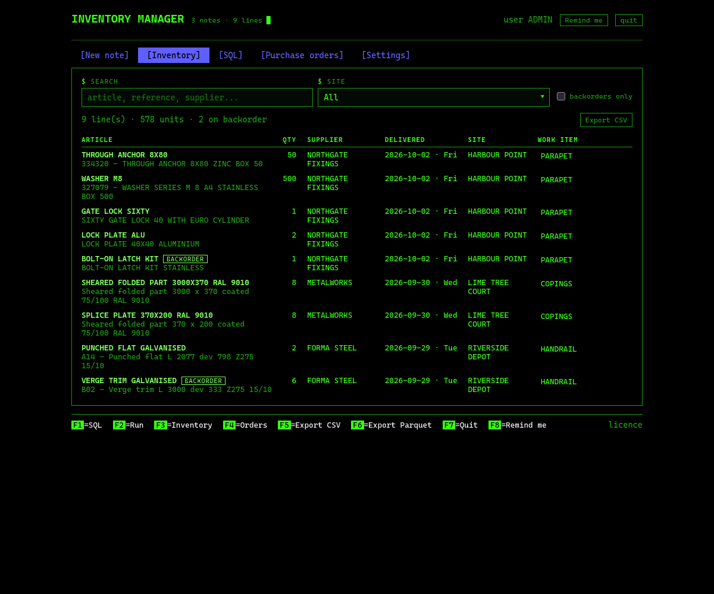
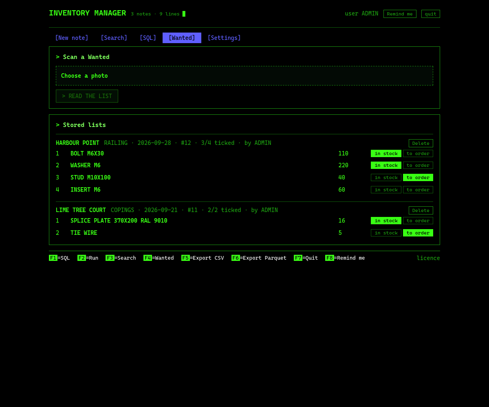
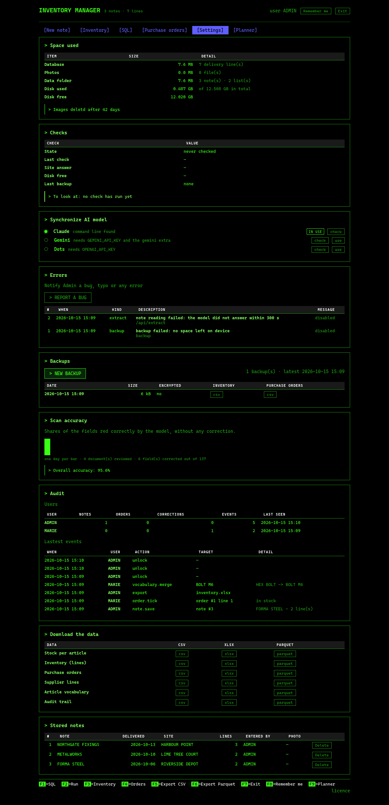

# Inventory manager

A software ERP for Inventory management. Photograph each Delivery note you receive and it is transcripted ,by duckdb, to a database*. You can then check the data under "Inventory", sort it, export it or query it with SQL.
Same for Purchase orders. The goal is to report a company's inventory without having to manually audit it. The two bottlenecks will narrow down stocks: hardware input and outputs. 
Custom built to answer a real company's needs on inventory tracking. 

each article stored in [inventory] database has its own line with indicators such as : name, quantity, supplier name, delivery date, order date, order reference and additional information.

for those stored in [Purchase order] "in stock" or "to order" clickable option are available: You can then export them as, regardless of the purchase order #, to bulk order them. 

```
photo -> model -> you check it -> DuckDB -> search, SQL, questions, exports
```

*computer vision is used, you must synchronize your AI model for recognition. More models compatibility to come.






## Install

Python 3.11

```bash
pipx install git+https://github.com/Louis31921c/Inventory-Manager.git#subdirectory=stock-manager
```


Once in, plug your model ;

Computer vision is used, you must synchronize your AI model for recognition. As of now, two models are compatible. More models to come. Feel free to make it run on your own model !

- **Claude Code CLI** (default): install it, run `claude` once and `/login`. No API key.
- **Gemini API**: `pip install "stock-manager[gemini]"`, then put `LLM_BACKEND=gemini` and
  `GEMINI_API_KEY=...` in the settings file.

Except snapping photos, Everything else works with no model at all.

## The password

The first time the window opens it asks for a name and a password. After that the
app is locked on every start for quick acess: the right password opens your data. You still can disconnect after each session but five wrong tries pause it for five minutes.

the session expires on its own after 12 hours.

## What protects the data

| Guard | What it stops |
|---|---|
| Loopback only, random port | nothing on the network can reach it |
| Password on open, scrypt hash, five tries per five minutes | someone sitting down at your machine |
| Signed session cookie, `SameSite=strict`, twelve hours | another site reusing your session |
| Origin check on every write | a page in your browser posting to the app |
| Read-only SQL, filesystem access off, one statement | a question turning into a delete |
| `0600` on the database, settings and account file, `0700` on the data folder | other accounts on the machine |
| 30 MB cap on uploads, photos purged after six weeks | the disk filling up quietly |
| Encrypted snapshots when `BACKUP_PASSPHRASE` is set | a stolen backup |

For a laptop that leaves the workshop, turn on full disk encryption.

### The five tabs

Press `1` to `5` to navigate between tables.

| Tab | What you do |
|---|---|
| New note | `R` snaps a photo. Correct the fields and lines, then save. |
| Search | `/` filters, `B` shows backorders only, `E` edits the work item of a line. |
| SQL | `Enter` query it yourself. You can export it as csv, parquet or xslx for more options. |
| Purchase orders | `R` reads a sheet. `S` in stock, `O` to order, `C` clears, `D` deletes. |
| Settings | `B` backup, `T` test message, `M` merge two names, `E` export, `P` purge photos. |

### Keys everywhere

| Key | Does |
|---|---|
| F1 | SQL tab |
| F2 | ask a question |
| F3 | search |
| F4 | purchase orders |
| F5 / F6 | export |
| F7 | quit |
| F9 | predictions |
| Ctrl-U | clear the line you are typing |
| Esc | cancel |


## Data in

Four ways in, all landing in the same queue on the first screen.

| Way in | What it takes |
|---|---|
| Take a picture | a delivery note or a purchase order, read on the spot |
| Import files | PDF, JPG, PNG, WEBP read like a photo; CSV and XLSX mapped column by column |
| Mailbox | attachments on unread mail, fetched on a timer or by hand |
| Terminal | `stock read`, as before |

The queue keeps one copy of each file: the same bytes twice, from a mail and from a folder,
stay one row. A scan waits for `read`, a spreadsheet for `map columns`.

### Spreadsheets

The column mapping is guessed from the header, in English or French (`article`, `quantite`,
`fournisseur`, `date livraison`, `chantier`), and you correct it before anything is written.
`Check` says what would be imported and what would be skipped, with the reason and the row
number; `Import` writes the lines as one note of their own, so an import can be found again
later. Pick `Supplier catalogue` as the target and the same file fills the catalog instead.

### Mailbox

Plain IMAP, set in `~/.config/stock-manager/settings.env`:

```
IMAP_HOST=127.0.0.1
IMAP_PORT=1143
IMAP_USER=you@proton.me
IMAP_PASSWORD=the-bridge-password
IMAP_FOLDER=INBOX
IMAP_SECURITY=starttls
IMAP_INSECURE=1
MAIL_EVERY_MINUTES=15
```

Those values are for **Proton Mail Bridge**, which runs on your machine and offers Proton over
IMAP on `127.0.0.1:1143` with a certificate of its own, hence `IMAP_INSECURE=1` for that host
only. It needs a paid Proton plan.

**Outlook.com and Microsoft 365 no longer accept IMAP passwords**: Microsoft retired Basic
authentication there and app passwords are not a way around it. Either use a corporate account
whose tenant still allows IMAP, or set an Outlook rule that forwards supplier mail to an
address this can read.

Only attachments are taken, and only the kinds this app can read. The message is marked read so
it is not picked up twice (`IMAP_MARK_READ=0` to leave it alone), and the poll runs every
`MAIL_EVERY_MINUTES` while the app is open. `Fetch now` and `Test the connection` are on the
first screen.

## Downloads

Three tables come out of the app, and they are the same three everywhere: the Settings tab,
and the buffers card in the DDMRP window.

| Download | What is in it | Key |
|---|---|---|
| Inventory lines | every line of every delivery note | `id`, with `note_id` and `line_no` as they were read |
| Purchase order lines | every line of every stored purchase order, with its sheet | `id`, with `list_id` and `line_no` |
| Safety stock watch | one row per article: rate, lead time, zones, net flow, what to order | `article` |

Each one comes as `csv`, `xlsx` or `sql`.

### Querying them in psql

The `sql` files are plain PostgreSQL. Every one of them creates the `stock` schema if it is
missing, creates its own table if it is missing, empties that table and fills it again, so a
file can be loaded as often as you like without piling rows up.

```
createdb workshop
psql -d workshop -f inventory_lines.sql
psql -d workshop -f purchase_order_lines.sql
psql -d workshop -f safety_stock.sql
```

The three relate through `stock.articles`, a one column table every file tops up and every line
points at, so the tables can be loaded in any order and joined straight away:

```sql
SELECT a.article,
       sum(i.quantity)     AS received,
       sum(p.quantity)     AS asked_for,
       max(s.top_of_green) AS buffer_top,
       max(s.zone)         AS zone
FROM stock.articles a
LEFT JOIN stock.inventory_lines i      ON i.article = a.article
LEFT JOIN stock.purchase_order_lines p ON p.article = a.article
LEFT JOIN stock.safety_stock s         ON s.article = a.article
GROUP BY a.article
ORDER BY received DESC NULLS LAST;
```

## Buffers

The DDMRP window sizes a buffer for every article, the demand driven way, out of what the
delivery notes already say.

| Zone | What it covers | How it is worked out |
|---|---|---|
| Red | the lead time and its surprises | `per day x lead days x lead factor`, plus that again times a variability factor |
| Yellow | the demand while the supplier works | `per day x lead days` |
| Green | how often you want to place an order | the larger of `per day x lead days x lead factor` and `per day x order cycle` |

Lead days are measured, not guessed: the median of `delivery date - order date` for that
article, falling back to the supplier's median, then to everybody's. A short lead gets a bigger
factor than a long one, and an erratic article a bigger safety than a steady one, which is why
two articles moving at the same rate can end up with very different red zones.

Net flow is what was counted on the shelf minus what the open purchase orders still ask for.
Against the top of each zone it lands in the red, the yellow, the green, or over the top, and
the table is sorted so the red comes first. Articles nobody counted are marked `not counted`
rather than assumed empty.

### Where the demand goes next

Every week of every article is labelled `quiet`, `light`, `usual` or `spike` against a week when
that article actually moved. Those labels make a Markov chain: one pooled transition matrix for
the whole workshop, since no single article moves often enough to fill one of its own. The table
under the buffers reads row by row: given this week, the chance of each kind of week next.

From it come two numbers. `spike` in the article's row is the chance of at least one
bigger-than-usual week inside the horizon, which is what a buffer has to survive. The long run
share under the table is where the weeks settle if nothing changes. Both are smoothed, so a
pair of states never seen together still gets a small chance rather than zero, and both are
honest about thin history: with a few weeks of notes the chain says more about the shape of the
work than about next month.

`export csv`, `export xlsx` and `export sql` take the whole table out, zones, factors and all.

## Predictions

`DDMRP`, on the menu bar (or `F9`), opens a window of its own.

| Cell | What it gives you |
|---|---|
| What left the stores | quantity booked in, week by week |
| Where it went | lines per site over the same window |
| In and out | quantities in against quantities out, per week, per month or per 6 months, with the net, and the table out as csv or xlsx |
| Buffers | the demand driven zones above, and the chain behind them |
| Dots orders for you | an OpenAI drafted purchase order to check and save |

In is what the delivery notes brought in. Out is what the purchase orders asked for over the
same stretch. Net is what the shelves kept.

`safety stock xlsx`, next to those exports, opens the safety stock sheet in Excel: a row per
article with its weekly rate, the swing around it, what is on hand, the safety stock and the
reorder point. Safety stock is the service factor times the week to week swing over the lead
time, and the reorder point is the lead time demand on top of it; the sheet is worked out over
a 7 day lead time at 95% service, or pass your own with
`/export/safety-stock.xlsx?lead=14&service=99`.

### Plutus and Terminus

The app runs two agents, both of them Claude, both of them narrow. They go out through one
door, so there is one timeout and one way for either to fail, and neither needs an API key:
they run the Claude Code command line that is already signed in on this machine.

| Agent | Asks | Cannot |
|---|---|---|
| **Plutus** | what does the planner's arithmetic say we should order? | sign anything — a draft is a draft until you save it |
| **Terminus** | is this article one we already know under another wording? | approve anything — the gate still waits for you |

Plutus had the purse; Terminus was the boundary stone nobody was allowed to move.

`draft the order`, on the Plutus card, hands it the planner's numbers
and gets a purchase order back: article, quantity rounded to how the trade buys, supplier,
and one clause saying why. Check it, change any quantity, then `save as purchase order` and it
lands in the Purchase orders tab like any other sheet.

Leave the **article** box empty and Plutus picks what is thin. Name one — or several, comma
apart — and it reads those instead. Part of a name is enough: `rondelle m8` finds whatever
the shelf calls it, and an exact name still wins over a part of one. An article asked for by
name is a different question from "what should we buy?", so Plutus is told which ones you
typed and orders them unless there is a reason not to, in which case the note says which one
and why. **site** and **work item** are the header of the order it writes, not a filter.

An empty draft is an answer, not a failure. The agent is told to leave out what is
comfortable, so a shelf in good order comes back with no lines and a note saying what it left
out and why.

Nothing is sent to a supplier. Plutus drafts, you sign, and the order stays in the app.

### Outlook without a password

Microsoft turned basic IMAP auth off for most tenants, so a password alone is refused however
right it is. Stock Manager signs in with a token instead, the device code way: it asks
Microsoft for a code, you type the code into microsoft.com/devicelogin in a browser, and the
refresh token stays in `~/.config/stock-manager/outlook-token.json`, readable by you and
nobody else. No token is ever shown back on a screen.

It needs an application of your own, because there is no shared one to ship:

1. Azure portal, App registrations, New registration. Any name, accounts in your own
   directory or in any directory as you prefer.
2. Authentication, Add a platform, Mobile and desktop, and switch **Allow public client
   flows** on. That is what enables the device code.
3. API permissions, Add, APIs my organization uses, **Office 365 Exchange Online**,
   Delegated, **IMAP.AccessAsUser.All**. Grant consent if your tenant asks for it.
4. Copy the Application (client) ID into Settings, Mailbox, and the tenant id too if you want
   it narrowed to one firm — `common` lets any account in.

Then press Sign in and type the code. An app password from your tenant still works if you
have one; leave the token switch off and use the password box as before.

```bash
pip install 'stock-manager[outlook]'
```

## The chat bot

Two doors onto the same room: Discord and Slack. Both answer `/basket`, `/basket_show`,
`/basket_clear`, `/purchase`, `/quote` and `/stock`, and both fill the same baskets and go
through the same gate. Each starts only if its tokens are set, so running one, both or
neither is a matter of what is in Settings → Chat bot.

Discord takes one bot token. Slack takes two, because it cannot knock on a door that is only
on loopback: the connection is made outward, in socket mode, so it wants a bot token
(`xoxb-`) for what it says and an app-level token (`xapp-`) for the socket itself.

`slack-app-manifest.yaml` saves the clicking. At api.slack.com, **Create New App → From an
app manifest**, paste it, and the bot user, the six commands, the scopes, socket mode and
interactivity are all made at once. Then generate the app-level token (Basic Information →
App-Level Tokens → `connections:write`), install to the workspace for the bot token, paste
both into Settings → Chat bot, and `/invite` the app into the channels it should answer in.
**Test the connection** tries both tokens and says which one is wrong if either is — they are
easy to paste the wrong way round.

A Slack slash command carries one line of free text where Discord carried a form, so on Slack
`/basket` with nothing after it opens the same form as a dialog, and `/basket` with something
after it reads the line straight.

```bash
pip install 'stock-manager[discord,slack]'
```

If the socket dies with a `ContentEncodingError` the moment it connects, the machine's
`brotli` is older than the `aiohttp` using it: some distributions ship a 1.1.0 whose
`Decompressor.process` takes only the data, while aiohttp calls it with a length as well.
`pip install --upgrade 'Brotli>=1.2'` into the same environment settles it, and the slack
extra asks for that version for exactly this reason.

## The purchase gate

A basket is free: anyone in the chat can fill one, and `/basket` now takes the price off the
shop page with it — `12 vis th 6x25 @ 0.11, 4 rondelle m8`. Buying is not free. `/purchase`
reads the basket first, and five things hold it back for a person:

| Why | What it means |
|---|---|
| first article | this article has never been bought before |
| new supplier | the article is known, this supplier is not |
| over the ceiling | the basket comes to more than 500 EUR |
| dear line | a line costs more than twice what that article usually costs |
| no price | a line carries no price, so neither money rule can be checked |

A held basket goes through two checks, and they are two different questions.

**Terminus** — Claude, reading the names — answers *is this the article we already know
under another wording?* The chat asks for `CHEVILLE SPIT FIX 10x100`, the shelf knows
`343546 - CHEVILLE SPIT FIX 3 10X100`. It answers same, new or unsure, with its reason. When it
cannot be reached, or is not sure, the answer is unsure and the basket waits for a person. With its
mode on (Settings, Rules for the two bots) Terminus then also decides: it approves a basket whose
every line is the same article inside its limits, and cancels a repeat, a twice-refused article or
a stale basket. Anything it leaves is the person's.

**You** answer the other question — *do we want this, at this price, from this supplier?* — on
the Waiting for you card, which is on the landing page and only appears when something is
waiting. Terminus' answer is evidence next to the basket, not a recommendation to accept.

An approval never expires; there is a Cancel instead. What it does carry is the price it was
given at, so an order placed long after a yes, at a price that has moved more than 10%, is
asked for again rather than going through at a number nobody agreed to.

Every turn of the gate is written to a sealed log: each entry carries the hash of the one
before it, so a line edited afterwards breaks the chain from there on and the card says at
which entry. Nothing is ever deleted — a cancel is an entry of its own.

**Blockchain**, on the menu bar, is where that log is watched. It is a hash chain kept in the
database here, not a network and not a coin: one local file, no peers, nothing to mine.

The screen draws the round the gate walks as a ring of wedges, one a step, each with its own
glyph and its name outside it, redrawn every few seconds while you are looking at it. The
colour says one thing each: **green** is a step that is done, **yellow** is the one step
being waited on, **red** is something wrong. What has not come round yet is pale, and the two
steps that are not built are pale and dashed. The hub says which step the round is on, or
sends you to the line underneath when there is a fault.

| | | |
|---|---|---|
| 1 | reading what was asked | a basket is being filled in the chat |
| 2 | checking the shelf | what is already standing there, against what is asked for |
| 3 | Terminus reads the names | is this an article we already know? |
| 4 | the decision | whether it can go through, or has to be put to a person |
| 5 | waiting for you | nothing is bought until a person approves it |
| 6 | the wallet | *not built: nothing here holds funds or bills anything* |
| 7 | placing the order | *not built: an approved order is placed by hand* |

The two steps that are not built are drawn dashed rather than left out, because they are part
of the round even where the app does not walk them yet.

Red is only ever something actually wrong, so it has to come from something that is. Two
things turn a step red: the sealed log no longer holding, and Terminus having no command line
to run. One line under the round says which step and why, rather than leaving the colour to
be interpreted.

Step 2 says its piece out loud: if the shelf already holds more than twice what the basket
asks for, the screen names the article and by how much, since buying more of what is standing
there is the easiest mistake to make and the hardest to see. Approve and Cancel are on the
step itself, so a round can be ended where it is being read.

Above the round, how many baskets are held, waiting and approved. Nothing in flight says
nothing — an empty round is its own answer — but a sealed entry changed behind its back still
shouts, naming the one where the chain stops holding.

Every wedge of the round is a button. Click one and a small window opens with the audit of
that step, newest first, each row a time, a person, what happened and the detail:

| Step | What the window lists |
|---|---|
| 1 reading input | lines waiting in a basket, and every basket read for `/purchase` |
| 2 inventory check | each held basket, with the articles it flagged against what is known |
| 3 control | what Terminus said, request by request |
| 4 decision | every basket the gate stopped, and why |
| 5 manual check | every approval and every cancel, and who gave it |
| 6 wallet check | nothing: not built |
| 7 placing order | the baskets that became purchase orders |

`Esc`, the close button or a click outside shuts it. Only what was written down can be shown,
so a basket that was emptied by an order leaves step 1 and appears in step 7.

The name on the bar rolls down to what sits under the round. **Waiting on you** holds two
lists that are easy to confuse and mean different things:

- *Held baskets* — somebody ran `/purchase`, the gate fired, and it is stopped on you. There
  is a request, Terminus has read it or is reading it, and Approve and Cancel are on the row.
- *Baskets nobody has bought* — `/basket` filled them and `/purchase` was never run at all.
  Nothing is stopped; nobody has asked yet. A basket is emptied the moment it becomes an
  order, so whatever is still sitting in one has not been ordered.

A held basket keeps its lines, so it would show in both. It does not: a channel with a
request in flight is answered for once, on the first list.

**What Plutus drafted** is the other card under the round.

What an article usually costs is the middle of its recent prices, kept as each order goes
through. Early on there is no history and the price rules simply do not fire; the first
purchase gate covers that stretch on its own.

## The five doors on the landing page

Down the right of the logo, a fifth of its height each, with an icon and a name:

| Door | Opens |
|---|---|
| Slack | `app.slack.com/client` |
| Discord | `discord.com/channels/@me` |
| Outlook | `outlook.office.com/mail/` |
| Proton Mail | `mail.proton.me` |
| Supplier contacts | the contact sheet, in whatever opens a csv here |

The window is WebKit and not a browser, so none of them is a link: following one would walk
the app off its own page. The page asks the server by the door's name and the server hands
the target to the desktop, which opens the browser for the four and the spreadsheet for the
csv. The five names are fixed in `inventory/shortcuts.py`; the page never sends a url or a
path of its own, so there is nothing here to point at a file somebody else chose.

The contact sheet is `CONTACTS_CSV` in the settings file, and `supplier-contacts.csv` beside
the database when that is empty. A door whose file is not there says so rather than opening
nothing.

## A new database is never blank

The first time the app opens a database file that does not exist yet, it fills it with half a
year of made-up paperwork: delivery notes, customer orders, quotes, bills, hand counts, a
contact per supplier, baskets and held requests on the Blockchain screen. It ends today,
takes about twenty seconds, and happens once. Everything in it is invented, and the audit
says so (`sample.seed`, user `SAMPLE`).

A database that already exists is never touched, so this only ever runs on a new one.
`SAMPLE_DATA=0` in the settings file starts it empty instead. To clear a filled one, stop the
app and delete `~/.local/share/stock-manager/inventory.duckdb`, with `SAMPLE_DATA=0` set if
the next start should be blank.

`sample_data/make_sample_data.py` makes the same year, a whole one, as csv files and as a
database of its own to run a simulation on; the year itself is written in
`inventory/simulation.py`.

## Photos, the mailbox and the order queue

- **Photos are kept small.** A photo is read by the model as it was taken, then stored
  turned upright, cut to 1600 pixels on its long side and recompressed, with its metadata
  (where it was taken) dropped: about 250 KB for a 2 MB photo. `stock shrink` does the same
  to the photos already stored, in place. It is not kept as a pixel array, which would be
  larger than the file.
- **The mailbox reads the delivery notes.** With "Store notes by itself" on (Settings,
  Mailbox), each pdf or photo that arrives is read and, when it reads clean, stored as a
  note signed `MAIL`. A note with something to fix, a spreadsheet, or a file or subject
  saying facture, invoice, bill, avoir, devis or quote waits in the queue with the reason.
- **To order, waiting.** Lines ticked "to order" on a stored purchase order are read into
  a queue by Plutus (every hour, or the "read what is to order" button) and ordered
  fifteen days later as one purchase order a site and work item. Tick a line back to
  in stock and it leaves the queue. `stock sample` adds made-up quotes, part deliveries,
  bills and Blockchain baskets to a database that already has data.

## Running the logistics end to end

- **Suppliers (Purchase orders screen).** A stored purchase order, or a quote request, becomes
  one draft mail a supplier, written in French and addressed from the contact book. Nothing
  leaves until you press send on a draft you can edit. Sending needs a mailbox that takes
  outgoing mail (Gmail, Yahoo, iCloud, or Proton through the Bridge); Microsoft's sign-in only
  lets the app read, and any other server is set with `SMTP_HOST` and `SMTP_PORT` in the
  settings file. A reply from the supplier's address that names the order or quote number
  is filed against it by the mailbox check, and a date in it becomes the day to expect the
  goods. An order with no answer after 3 days, or past its promised day, gets a "chase"
  button that drafts a reminder; delivery-note lines owed late get a reminder per supplier.
- **Bills against deliveries (Bills screen).** Each bill is checked against every delivery of
  that supplier since its previous bill, priced at what the app has seen the articles cost.
  Over, under, unchecked (articles with no known price), nothing delivered, deliveries not
  billed for 45 days, and orders against what has come in. A gap can be marked disputed.
- **Stock control (Inventory screen).** Stock by site, transfers between sites, corrections
  that need a reason, reservations that an order for the same work item uses up, and a
  cycle count that asks for the busiest articles every 30 days, the next every 60, the rest
  every 90. A count's gap against the paperwork is kept as a movement.
- **Lead times (DDMRP screen).** Learned per supplier from the ordered and delivered days on
  the notes. An article with 3 or more deliveries is planned with its own (the day one
  delivery in five exceeds); the Lead setting is the fallback, and Plutus sees both.

## Control tower, prices, calendars, disputes, deliveries, archive

- **Landing dashboard and autonomy figure.** `/api/dashboard` lists the short articles with status,
  need date, blocked work, root cause, supplier lead time and action; `/api/autonomy` is the
  0 to 100 figure: a capability map of the architecture (19 weighted capabilities, each on a
  0 to 4 ladder of how much the software does without a person), see `autonomy.py`. It moves
  when a module is built or something is switched on, and ranks the gaps to build next.
  `/api/notices` is the list the hourly scan keeps (`watch.py`); critical and high ones are pushed
  once to the channels in `NOTIFY_VIA` (`slack`, `sms`, `mail`), and a digest goes at `NOTIFY_HOUR`
  (default 8). Nothing is pushed when `NOTIFY_VIA` is empty.
- **Quote answers and awards.** `pricing.py`: one offer per quote line (price, lead days, validity),
  `ask_others` copies a request to other suppliers, `compare` marks the cheapest and fastest, `award`
  makes an agreement that ends the earlier one, enters the price history and decides which supplier
  an order draft uses.
- **Pack sizes** (`units.py`) turn a wanted quantity into whole packs, at least the minimum; the order
  mail says so. **Calendar** (`workdays.py`): French holidays, your closures, per-supplier cut-off
  and shut weekdays, used for every expected date. Bills in another currency are matched in euros at
  the last rate on their date (`fx_rates`, filled by hand or from the ECB).
- **Disputes** (`disputes.py`): opened from a mismatched bill, a mail drafted with the deliveries,
  closed when credit notes cover 98% of the claim. **Deliveries to sites** (`outbound.py`,
  `documents.py`): dispatch, load, sign, with a delivery note PDF, labels, and the order PDF attached
  to supplier mails (needs `reportlab`, now a dependency).
- **Photo archive** (`archive.py`). After `PHOTO_RETENTION_DAYS` (42) a photo is levelled, reduced to
  one bit a pixel, packed and compressed into `photo_archive` (about 30 KB for 1.6 MB) and the file
  is deleted; the photo routes fall back to it. Kept `DOCUMENT_RETENTION_YEARS` (10). `stock archive`
  packs everything now. PDFs stay as files.
- **One connection stays open** while the server runs (`db.keep_open`), so the database file is
  never shut under a concurrent request; the SQL screen asks its read-only question on a snapshot.

## Policies and the bots' charters

- `policies.py`: rules for `send_order`, `send_chase` and `approve`. Off until the kill switch is
  on; a new policy is inactive and in dry run and needs `MIN_DRY_DAYS` (3) before it can go live;
  `HARD_CEILING` (5000 EUR) cannot be raised. Run hourly by the server and, for baskets, right after
  Terminus has checked one. Every decision is a row in `policy_log`; actions are audited as POLICY.
- `bot-rules/` (next to this file): `plutus.md` and `terminus.md`, the charters as plain text, read when
  `BOT_RULES_DIR` points at the folder (the built-in text is used otherwise, and for anything a file
  leaves out). Edited files apply on the next request.
- `wallet.py`, `purchasing.py`, `payments.py`: the wallet ledger Plutus spends from, Plutus sending orders, approving and
  placing baskets and paying matched bills (hourly, `POST /api/plutus/run`), and the SEPA batch a payment goes into.
- `replenish.py`: Plutus's DDMRP ordering on a rhythm: one cycle order every `cycle_days` (14) on `order_weekday`,
  an urgent order between (once a day), checked hourly by the server; `POST /api/replenish/run?kind=cycle|urgent`,
  switch at `/api/replenish/auto`.
  `judge.py`: Terminus approves and cancels held baskets (off, dry run, live after 3 days; `/api/judge`).
- `charters.py`: freedom, prohibitions and numeric limits for Plutus and Terminus (`bot_limits`).
  Added to the model's prompt and enforced again on its answer: `enforce_plutus` cuts or corrects
  draft lines, and `verify.check` turns a doubtful "same" into "unsure".

## Where things are stored

| What | Path |
|---|---|
| Database and photos | `~/.local/share/stock-manager/` |
| Settings | `~/.config/stock-manager/settings.env` |
| Exports | `~/.local/share/stock-manager/exports/` |
| Backups | `~/.local/share/stock-manager/backups/` |

Override the data folder with `--data /some/path` or `DATA_DIR`. Copy `.env.example` to the
settings file to see every key.

## what it does that a spreadsheet does not

Article name memory : if you corrected/ tweaked a input after snapping a photo, the algortihm remembers it and wont (at least very not likely) do the same mistake twice : 

Audit trail : Every save, correction, tick, merge, backup and export is written down with the
user name, which is your login name.

**Errors that reach you.** Any failure is referenced with a "#", a row in the database and, with
`SMS_PROVIDER` set, a text message: `Stock manager error #14: backup failed - no space left on
device` to the Admin. Repeats are muted.


## Settings



- space used gives an indicator on what is used and the space left : snapshots are deleted after 6 weeks not to skyrocket your cloud/disk usage
- checks on last backup, functionement state and its last check, and more...
- synchronize AI to pick your Model. can be plugged to Open AI dots for reordering automation. More models/ suppliers to come.
- Errors where tickets are directly sent to a phone number. you can see the lastest tickets sent
- backups
- Model accuracy, or how many time on average have you corrected what the model input after snapping a note
- activity audit, where you can openly track each users activity on the software. can be hidden, for admin only, as a json file.
- export/ download each tables, under different formats
- stored notes tracking


## Files roles

| File | Role |
|---|---|
| `inventory/tui.py` | the full screen program: screens, keys, curses loop |
| `inventory/cli.py` | the commands |
| `inventory/screen.py` | the character grid both the terminal and the screenshots draw into |
| `inventory/db.py` | DuckDB storage and exports |
| `inventory/intake.py` | the queue of files waiting to be read |
| `inventory/mailbox.py` | IMAP: attachments out of unread mail |
| `inventory/sheets.py` | CSV and XLSX into lines or the catalogue |
| `inventory/pg.py` | the PostgreSQL dumps |
| `inventory/llm.py` | the model backends, Dots among them |
| `inventory/forecast.py` | rates, safety stock, reorder points, shortage risk |
| `inventory/ddmrp.py` | buffer zones, lead times, the demand chain |
| `inventory/vocabulary.py` | shared article names, aliases, merges |
| `inventory/shortcuts.py` | the five doors on the landing page |
| `inventory/audit.py`, `alerts.py` | who did what, and what broke |

## Contributions / Updates
- built in indicators
- encryption, safe share, global security
- more compatibility to different tools, models...
- storage space optimization
- overall growth
## Licence

Proprietary: see [LICENSE](LICENSE). Copyright Louis31921c, all rights reserved. Not open source.

What comes back from a photo is a draft. Models misread quantities, references and dates, which is
why the correction step exists. This is not a system of record.
