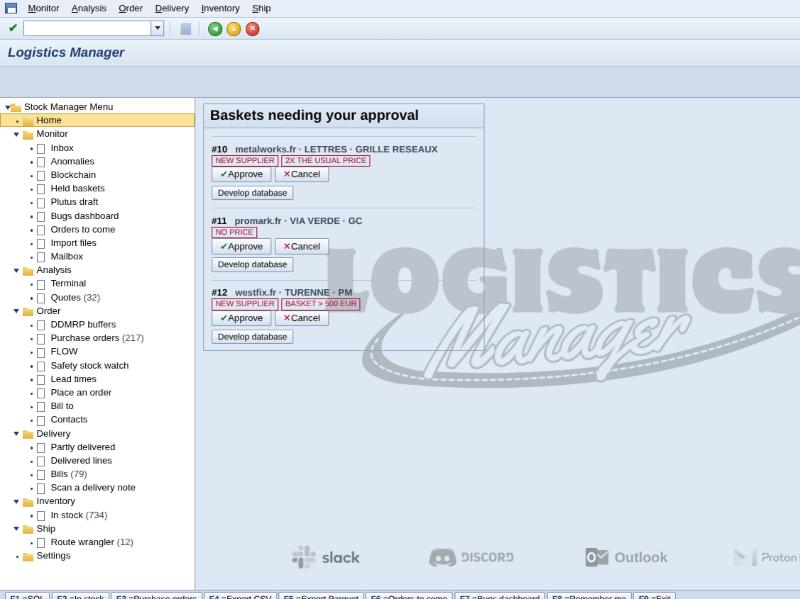
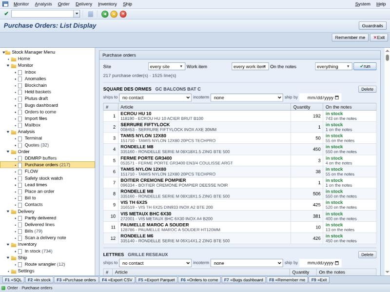
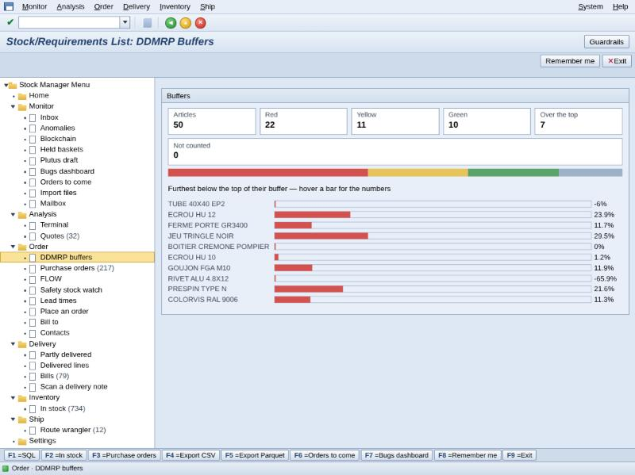
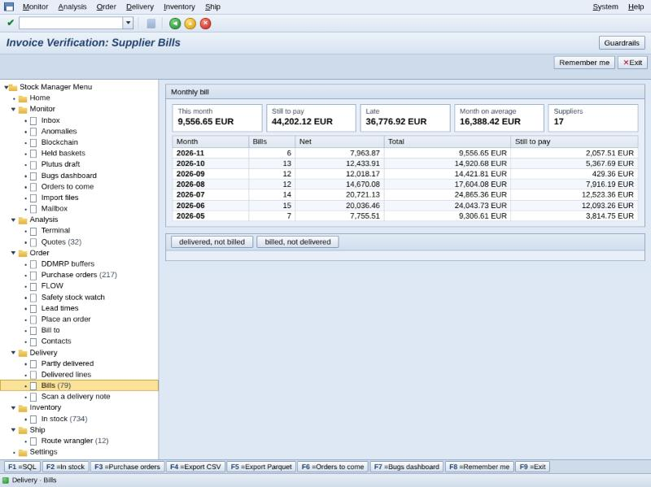
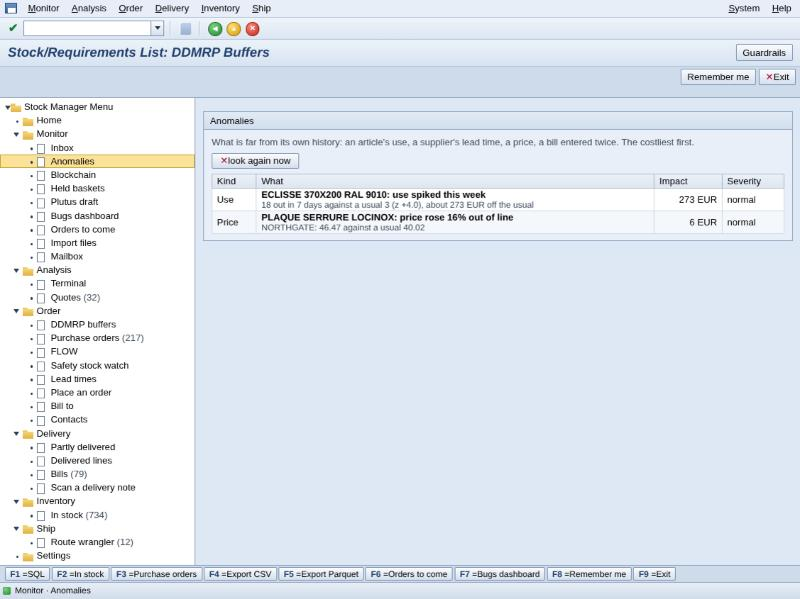

# Logistics Manager

One desk for a logistics manager's week: what arrived, what is on the shelf, what to order,
who to chase, what to pay. Take a photo of a delivery note and the app reads it. Everything
is kept in a single database file on your own computer, and nothing leaves it unless you
switch a connection on.



## What it does

**Receiving.** Photograph a delivery note or a customer order, or let the app pick them up
from your mailbox. It reads supplier, dates, site, and every line with its quantity and
whether part of it is still owed. You check what it read, correct it, and save. When you
correct something, it remembers, so the same mistake is much less likely next time.

**Knowing what you have.** The stock is worked out by itself: what came in on the delivery
notes, minus what went out on the customer orders. You can search it, count it by hand, move
stock between sites, and see how many days each article will last.



**Knowing what to order.** For each article the app keeps a "buffer", a red, yellow and green
band that says how much you should hold given how fast it sells and how long the supplier
takes. Red means order now. It learns each supplier's real delivery time from your own notes,
and it respects supplier holidays and cut-off times.



**Ordering.** Turn a shortage into a purchase order, ask suppliers for quotes, compare their
answers, and send orders by mail. A shopping basket filled in your team chat (Discord or
Slack) becomes an order too.

**Paying.** Every supplier bill is checked against what was really delivered and at what
price. The screen tells you which bills are right, too high, too low, or duplicated, and helps
you open a dispute and chase a credit note.



**Watching.** The app looks every hour for things that look wrong: an article suddenly used
far more than usual, a price that jumped, a supplier getting slower, a bill entered twice.
It lists them by how much money is at stake.



**Delivering.** Plan the van round to your sites, load it, and have the delivery signed, with
a printed delivery note and labels.

## Two helpers, with a leash

The app can run two narrow AI helpers. Neither has an API key of its own.

- **Plutus**, the buyer: drafts and places orders from the buffers, from a budget you fund.
- **Terminus**, the gatekeeper: checks that an article in a basket is really the one you
  already know under another name.

Both are held in by rules you write in plain text (see `bot-rules/`). Limits are applied again
by the program, so a helper that ignores its instructions changes nothing. A basket that is a
first purchase, a new supplier, over 500 EUR, or twice the usual price waits for a person.
Every new rule starts in a test mode that only pretends, and a kill switch stops everything.

## Safe by default

- It only listens on your own computer, and asks for a password when it opens.
- The database and settings can be read by your account only.
- Every save, correction, order and export is written to a log that cannot be edited without
  it showing, so you can always see who did what.
- Photos are shrunk to small black-and-white scans after six weeks and kept for ten years.
- Backups can be encrypted with a passphrase.

## Try it

You need Python 3.11 or newer.

```bash
pipx install git+https://github.com/Louis31921c/Inventory-Manager.git#subdirectory=stock-manager
stock-manager
```

The first time, you choose a name and a password. A brand new database starts with half a year
of invented paperwork, so there is something to look at straight away. Everything in it is
made up. To start empty instead, set `SAMPLE_DATA=0`.

To read photos you need an AI model. The default is the Claude Code command line, already
signed in on your computer (no key needed); Gemini also works. Everything except reading
photos works without any model.

Your data lives in `~/.local/share/stock-manager/`, and your settings in
`~/.config/stock-manager/settings.env`. To use another folder, set `DATA_DIR`.

## Going further

- [FEATURES.md](FEATURES.md): every function, one by one.
- [STATES.md](stock-manager/STATES.md): the life cycle of every order, bill, delivery and basket.
- [bot-rules](bot-rules/): what each helper may and may never do.

## Licence

Proprietary: see [LICENSE](LICENSE). Copyright Louis31921c, all rights reserved. Not open
source.

What comes back from a photo is a draft. Models misread quantities, references and dates, which
is why there is a checking step. This is not a system of record.
